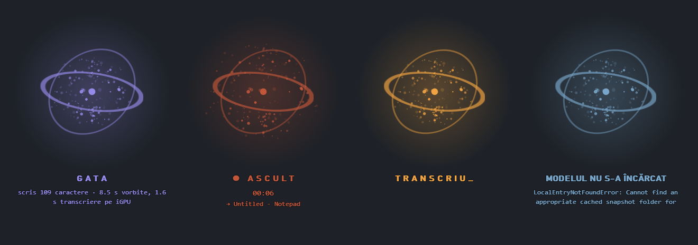

# Iris

Iris is a local voice dictation tool for Windows: you speak, and the text is typed into whatever
text box has the cursor — a chat, a terminal, an editor, Notepad. Speech recognition runs
entirely on your own machine with Whisper (`large-v3-turbo`), so nothing you say leaves the
computer, there is no account and no per-use cost. It types the text and stops: it never presses
`Enter`, so you can read what came out before sending it anywhere.

Related project: [JA.S.Mine](https://github.com/Mihai-Streanga/Jasmine-public), a personal
assistant whose voice dictation reuses the engine measurements made in Iris.

## What makes it reliable

- **Accuracy beats speed.** In the private repository, every change to the engine is measured
  against a versioned corpus of the author's recorded dictations, with an automatic verdict; a
  tuning that loses a single word on the corpus is rejected, however much faster it is. The one
  exception, the faster iGPU route for short dictations, is a written decision, flagged in every
  measurement round.
- **Nothing leaves the machine.** There is no network layer at all: no HTTP client, no socket,
  no open port. Audio stays in memory and is never written to disk.
- **You stay in control of the text.** Iris never presses `Enter`, and when the target window
  refuses the text it falls back to the clipboard and says so, rather than typing it somewhere
  else.
- **Speed-ups never change the text.** Work started in the background while you are still
  talking is reused only if it is bit-for-bit what the final pass would compute.
- **31 tests**, with no microphone, window or network; the two that need the real model are
  skipped with their reason when it is absent, never failed.

Code comments are in Romanian.

## Screenshots

The window is a small floating "pulsar" with no frame; its colour is the state. Rendered
offline from the program's own drawing code (`pulsar.py`, `fereastra_libera.py`) on a plain
background — see [How the screenshots were made](#how-the-screenshots-were-made).



## How it works

1. **Listen** — a global hotkey (or a click on the pulsar) opens the microphone; audio is kept
   in memory only, never written to disk.
2. **Route** — when you stop, the length of the recording is known exactly. Up to 30 s it goes
   to the Intel iGPU through OpenVINO (fast, greedy decoding); longer dictations go to the CPU
   through faster-whisper (beam search 5). Without OpenVINO or an Intel GPU, everything runs on
   the CPU.
3. **Pre-encode** — on long dictations, the first 30 s window is encoded in the background
   while you are still talking, and reused only if it is bit-for-bit what the final pass would
   compute. It changes the speed, never the text.
4. **Clean** — whitespace and line breaks are collapsed (a `\n` would send a half-finished
   message in a chat box), filler sounds and known Whisper hallucinations
   ("thanks for watching"-type sentences) are removed, whole sentences only.
5. **Type** — the text is sent to the window where you started, as Unicode keystrokes
   (`SendInput`), without touching the clipboard. If that window can't be found or refuses
   focus, the text goes to the clipboard instead and the window says so.

## Tech stack

| layer | what |
|---|---|
| language | Python 3.14 |
| UI | Tkinter, plus a layered Win32 window with per-pixel alpha (`ctypes`) |
| drawing | NumPy (the pulsar is rendered as an RGBA array every frame) |
| audio capture | sounddevice (PortAudio) |
| CPU engine | [faster-whisper](https://github.com/SYSTRAN/faster-whisper) 1.2.1 (CTranslate2, int8) |
| iGPU engine (optional) | [OpenVINO GenAI](https://github.com/openvinotoolkit/openvino.genai) 2026.4.1 `WhisperPipeline` |
| model | Whisper `large-v3-turbo`, from the Hugging Face cache, loaded with `local_files_only=True` |
| Windows integration | `ctypes` only: `SendInput`, `RegisterHotKey`, named mutex, layered windows |

There is no network layer in the program: no HTTP client, no socket, no open port.

## Installation

Requirements: Windows 11, 64-bit (the only version tested), Python 3.14 with the `py` launcher, a microphone, ~5 GB of
free disk space (3.3 GB models, 0.6 GB environment) and ~4 GB of free RAM. The iGPU route needs
an Intel GPU with a recent Intel graphics driver; without it Iris works the same, only slower on
short dictations.

1. Get the code and create the environment:

   ```bat
   git clone https://github.com/Mihai-Streanga/Iris-public.git
   cd Iris-public
   py -3.14 -m venv .venv
   .venv\Scripts\python.exe -m pip install -r requirements.txt
   ```

2. Check the environment:

   ```bat
   .venv\Scripts\python.exe -c "import faster_whisper, ctranslate2, av, openvino_genai, sounddevice, numpy; print('ok')"
   ```

3. Download the models once (~3.3 GB, into `%USERPROFILE%\.cache\huggingface\hub\`). Iris
   itself never downloads anything: a missing model is reported in the window at startup.

   ```bat
   .venv\Scripts\python.exe -c "from huggingface_hub import snapshot_download; snapshot_download('mobiuslabsgmbh/faster-whisper-large-v3-turbo'); snapshot_download('OpenVINO/whisper-large-v3-turbo-fp16-ov')"
   ```

   The second model is only needed for the iGPU route; skip it and set `"granita_igpu": 0` to
   stay on the CPU.

No `.env` file and no API keys are needed. `.env.example` only lists two optional
`huggingface_hub` variables (model location, offline mode).

## Usage

Start without a console window:

```bat
porneste-iris.vbs
```

or with a console, to see the diagnostic line:

```bat
.venv\Scripts\python.exe iris.py
```

| action | how |
|---|---|
| start listening | `Ctrl+Alt+Space`, or click the pulsar |
| stop and type the text | `Ctrl+Alt+Space` again, or click |
| cancel without typing | `Ctrl+Alt+X` |
| move the window | drag the pulsar (the position is remembered in `stare.json`) |

There is no silence timeout: pauses don't cut you off, you decide where the sentence ends.
A second launch doesn't start a second copy — it brings the running window to the front.

| colour | state |
|---|---|
| dim grey | loading the models |
| cool violet | ready |
| **red** | listening — particles move with the microphone level |
| amber | transcribing |
| ice blue | error (the reason is written under the pulsar) |

### Example output

The two engines and the text cleanup, run on **fictional audio**: a sentence synthesized with
the Windows text-to-speech voice *Microsoft Zira* (English, since no Romanian voice was installed),
with `limba` switched to `en` for this run only. The pipeline is the program's own: the model
loaded as in `iris.py`, `Iris._incarca_igpu` for the iGPU, `curata()` for the cleanup. Timings are
from an Intel Core Ultra 7 255H with an Arc 140T iGPU.

```text
audio: 8.5 s, fictional sentence, Windows TTS voice (en-US)

[CPU] faster-whisper, int8, beam 5
  loaded in 3.0 s
  raw:   ' Hello. The weekly meeting moves to Thursday at 10. Um, please send the draft report to the team before noon.'
  typed: 'Hello. The weekly meeting moves to Thursday at 10. Um, please send the draft report to the team before noon. '
  scris 109 caractere · 8.5 s vorbite, 7.1 s transcriere pe CPU

[iGPU] OpenVINO WhisperPipeline, greedy
  compiled in 8.6 s
  typed: 'Hello. The weekly meeting moves to Thursday at 10. Um, please send the draft report to the team before noon. '
  scris 109 caractere · 8.5 s vorbite, 1.6 s transcriere pe iGPU
```

The last line of each block is the status the window shows after typing. The English "Um"
survives because the filler list in `iris.json` is Romanian. On Romanian text (fictional, no
model involved), the cleanup removes fillers, line breaks and whole hallucinated sentences:

```text
raw:   ' Deci, ăăă, mutăm ședința de joi\n la ora zece. Mulțumim pentru vizionare!'
typed: 'Deci, mutăm ședința de joi la ora zece.'
raw:   ' Hmm, trimite raportul echipei până la prânz.'
typed: 'trimite raportul echipei până la prânz.'
```

### How the screenshots were made

Iris allows only one running instance, so the image was not taken from a live window. It was
rendered with the program's own drawing code — `pulsar.Pulsar`, `fereastra_libera.Scena` and
`masca_text` (Windows GDI fonts) — at 150% scale, composited on a dark background, with the
status texts the program writes in each state. The "ready" line is the one from the iGPU run
above; the target window "Untitled - Notepad" is an example; the error is the real one the
model loader gives with an empty Hugging Face cache.

## Configuration

Everything is in `iris.json` (read once at startup; restart after a change). Keys missing from
the file take the defaults from `IMPLICITE` in `iris.py`.

| key | in `iris.json` | what it does |
|---|---|---|
| `model` | `large-v3-turbo` | Whisper model for the CPU engine |
| `device` / `compute_type` | `cpu` / `int8` | where it runs and at what precision |
| `cpu_threads` | `8` | threads for the CPU engine |
| `limba` | `ro` | forced language; set `en`, `de`, … for another language |
| `beam_size` | `5` | beam width on the CPU engine |
| `prompt_initial` | a sentence | vocabulary hint: words you use often |
| `granita_igpu` | `30.0` | dictations up to this many seconds go to the iGPU; `0` disables the route |
| `model_igpu` | (default) `OpenVINO/whisper-large-v3-turbo-fp16-ov` | model for the iGPU engine |
| `hotwords` | a list | vocabulary for the iGPU engine — required there, since its prompt only conditions the first 30 s window |
| `devans` | (default) `true` | background pre-encoding of the first window on long dictations |
| `dispozitiv_intrare` | `null` | microphone: `null` = system default, or a `sounddevice` index |
| `esantionare` | `16000` | sample rate in Hz |
| `plafon_secunde` | `600` | a forgotten open microphone closes itself after this long |
| `spatiu_final` | `true` | adds a space after the text, so the next dictation doesn't stick to it |
| `per_lot` / `pauza_lot` | `32` / `0.002` | typing in batches; some apps drop events from one large block |
| `tasta_comuta` / `tasta_anuleaza` | `ctrl+alt+space` / `ctrl+alt+x` | global hotkeys (at least one modifier) |
| `intensitate` / `voal` / `contur_text` | `1.0` / `0` / `0.55` | brightness of the drawing, dark backdrop under it, outline under the letters |
| `sunete`, `sunete_fisiere`, `volum_sunete`, `volum_pe_sunet` | on, 4 files | sound cues; `""` for a file mutes it. The sounds are synthesized by `fa-sunete.py` |
| `balbe` | regex list | filler sounds removed when they stand alone (Romanian: „ăăă", „hm") |
| `halucinatii` | regex list | whole sentences removed as known Whisper artefacts |

`stare.json` (window position) and `arata.semnal` (the "show yourself" signal from a second
launch) are written by the program and ignored by git.

`fa-sunete.py` and `fa-pictograma.py` regenerate `sunete/*.wav` and `iris.ico`; their output is
already in the repository.

## Tests

```bat
.venv\Scripts\python.exe -m pip install -r requirements-dev.txt
.venv\Scripts\python.exe -m pytest
```

31 tests: text cleanup and configuration (`test_text.py`), hotkey parsing, UTF-16 typing units
and the pulsar drawing (`test_ferestre_pulsar.py`), the status line fitting the window
(`test_eticheta.py`), and 2 integration tests that load the real
Whisper model from the local cache (`test_model.py`). No microphone, window or network is used.

Without the model in the Hugging Face cache, the 2 integration tests are **skipped** with the
reason, not failed. Result in a fresh environment built only from `requirements-dev.txt`:

```text
with the model downloaded:     31 passed in 2.93s
with an empty model cache:     29 passed, 2 skipped in 0.55s
SKIPPED [1] tests\test_model.py:26: modelul `large-v3-turbo` nu e în cache-ul HuggingFace (LocalEntryNotFoundError); vezi README, pasul 3
```

There is no API key or external service to mock: the only thing the tests can't do without
downloading ~1.5 GB is run the model.

## Known limitations

- **Windows only.** Typing, hotkeys, the window and the sounds all use Win32 APIs directly.
- **Romanian by default.** The filler and hallucination lists in `iris.json` are Romanian; for
  another language change `limba`, `prompt_initial`, `hotwords` and those lists.
- **The iGPU route trades some accuracy for speed.** OpenVINO's `WhisperPipeline` has no beam
  search on GPU, so short dictations are decoded greedily; on the author's own recordings it got
  a word wrong on about 1 in 20 short dictations where the CPU engine did not. Set
  `"granita_igpu": 0` if you prefer accuracy everywhere.
- **Long dictations are slow on CPU**: on an Intel Core Ultra 7 255H, a one-minute dictation
  takes ~15 s to come back; short ones (iGPU) ~0.6 s.
- **Models are not downloaded automatically** and take ~3.3 GB on disk, ~3.3 GB of RAM with both
  engines loaded.
- **Elevated windows can't receive the text**: Windows blocks simulated keystrokes from a normal
  process into a window running as administrator, and the keystrokes are dropped silently. Run
  Iris elevated too if you need that.
- **`av` is pinned to 18.0.0** because 18.1.0 and 19.0.0 were blocked by Windows App Control
  (Smart App Control) on the reference machine; the reason and a re-check command are in
  `requirements.txt`.
- **The measurement corpus is private.** The accuracy and speed figures come from the author's
  own voice recordings, which stay in the private repository together with the benchmark
  scripts.
- Pinning to the taskbar works reliably only through a Start Menu shortcut that carries the same
  AppUserModelID (`Mihai.Iris`) as the program.

## How it was built

Iris was built with Claude Code, by a domain expert working as architect and judge of every
result, on the [Streanga Method](https://github.com/Mihai-Streanga/streanga-method-for-claude).
Three of the twenty verification patterns in the method's catalogue were first proven here: a
versioned corpus with an automatic verdict, a recorded corpus run through the product's own
chain, and measurement kept as a set of commands. Iris is also where the method showed that a
rule enforced by a tool holds where a written one does not: its commit convention was missed in
20 commits out of 20 while it was only written down, and in 0 out of 39 once a tool enforced it.
The design decisions, each with its reason and measurement, are in [docs/DESIGN.md](docs/DESIGN.md).

## License

[MIT](LICENSE) © 2026 Mihai Streanga
